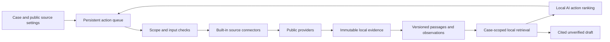

# Local OSINT engine: scope and design

Canonical architecture, updated 2026-10-16. Historical implementation/validation
receipts remain in [validation.md](validation.md); their older limits are not the
current configuration contract.

## Outcome and scope

A person, organization, domain, topic or other subject starts an investigation
without needing a Wikipedia entry. Public collection is external; evidence,
extraction, search, namesake comparison and optional llama.cpp processing are local.
One Investigate action selects a source recipe, starts available cached local AI,
collects public evidence and evaluates the public question. Source selection is
not required. Advanced controls expose actual inputs/results and recovery.
Existing cases and original evidence must survive upgrade and interrupted work.

The implementation extends the existing standard-library Python/SQLite engine,
authenticated static UI, owned nginx and owned local model. New connectors use
one trusted registry and dispatcher. No cloud processing, arbitrary plugins,
password-reset enumeration, breach aggregation, login bypass or shell tools are
introduced. The OSINT4ALL catalogue informed curation; bookmarks are not executable
configuration and the catalogue is never imported wholesale.

## Architecture

| Module | Responsibility |
| --- | --- |
| `engine.py` | Cases, immutable originals, extraction, consistent export/backup and schema opening |
| `workspace.py` | Schema-3 migration, actions/attempts, questions, identity decisions, origin lineage, versioned document passages, source health and retrieval |
| `connectors.py` | Trusted source metadata, exact input validation, response normalization and original retention |
| `frontier.py` | Public-scope enforcement, queue dispatch and permitted source-driven follow-ups |
| `planner.py` | Automatic subject recipes, question evaluation, literal-source-backed AI proposals and provider/strategy recovery |
| `documents.py` | Bounded local PDF/office/image extraction and supervised native OCR |
| `investigation.py` | Existing discovery, provider recovery, useful-page accounting, budgets, job control and AI integration |
| `ai.py`, `prompts.py` | Owned cached-model runtime, bounded action/extraction/draft requests and eight configurable prompt stages |
| `search_service.py` | Explicit official-image setup and ownership-scoped SearXNG lifecycle |
| `owned_process.py`, `nginx.py`, `server.py` | Owned-process receipts, loopback proxy/API, authentication and page leases |
| `static/` | Source configuration, run controls, visible queue/tool outcomes, candidate observations and evidence inspection |

Python runtime requires no third-party packages. FTS5 is optional and falls back
to local literal matching. nginx is required by canonical launch, llama.cpp and a
cached GGUF by optional analysis, Docker by optional metasearch. Dependency setup
is explicit; an investigation cannot silently install them.

## Source registry and configuration

Built-in adapters cover Crossref, GitHub public API, selected GitHub/GitLab public
profiles, website/feed/sitemap discovery, Wayback availability, Common Crawl index
metadata, WebFinger, public ActivityPub actors, GeoNames place references, local
email headers and owned SearXNG.
Existing public search, encyclopedia, news, page and domain tools remain canonical.
The registry declares inputs, destination families, target types, provenance,
licence, bounds and current availability. Settings select trusted implementations;
they cannot define executable handlers or arbitrary endpoints.

Case source settings are:

| Key | Contract |
| --- | --- |
| `packs` | Additional registry IDs; automatic recipes select website/archive/index sources and relevant target-specific additions |
| `public_usernames` | Up to 100 explicitly approved handles; automatic checks do not expand this list |
| `seed_urls` | Up to 100 public HTTPS starting URLs, distinct from private case identifiers |
| `runtime_seconds` | Nonnegative exact integer; default 300; zero removes the soft elapsed deadline |
| `keep_working` | Page-scoped continuous-work selection; does not remove independent budgets or cancellation |

The primary UI submits `automatic: true` and public `question`, `public_country`,
`public_language` and `public_organization` fields in run options. These fields may
be disclosed to providers, unlike private comparison clues. The new-case dialog
can collect them before the first run. The worker starts the available cached AI
by default, or continues deterministic recipes if preparation fails. AI preparation
has its own bound rather than silently spending a short collection deadline.
The UI saves source settings before Investigate/Continue. Single-source forms authorize exact
shown inputs independently. Recovery rechecks current permissions at dispatch.
Source results distinguish success, empty, blocked, rate-limited, uninterpretable
and error. Original response bytes are saved where available, including supported
HTTP failure responses; absence of interpretable records is not false proof of no
public footprint. Public-profile success requires matching account metadata;
HTTP status alone does not establish existence or target ownership.

## Persistent work and recovery

Actions persist connector, exact arguments, purpose, candidate/evidence lineage,
priority, attempts, result/error and cooldown. The deduplication key preserves
phrases, operators, pagination and source/candidate scope. New work can arise from
approved starting URLs, selected structured sources or relevant discovered links,
feeds, sitemaps and public metadata. A finite keyword list is no longer the only
mechanism for continued collection.

The automatic controller chooses subject-specific public search strategies across
selected providers, ranks links to relevant public pages/documents and follows
saved-source leads. Local AI can propose a typed search, a literal URL or exact
federated account using an offered source ID and a quote verified against that
source. Public vocabulary and private-clue checks apply before enqueue/dispatch.
A separate bounded queue chooser selects existing action IDs where used.
Repetition, ungrounded proposals and unavailable planning fall back to deterministic
recipes, source-family changes and another permitted provider. The UI exposes retry, skip,
prioritize, edited rerun and resume without discarding earlier attempts/evidence.

States include pending, running, cooldown, blocked, complete, failed, skipped and
`interrupted_after_dispatch`. Dispatch records intent before the external read;
completion records outcome afterward. A hard crash between them leaves an unknown
remote outcome. Resume can repeat read-only requests and preserves the prior
attempt. No distributed exactly-once guarantee is possible. Cooldown/connector
health survives restart and retry cannot erase an active rate-limit deadline.

Request ceilings, useful-page goals, Stop and per-request bounds operate separately
from elapsed runtime. The page goal limits page collection but cannot declare questions answered or
identity established. Final status remains partial if required questions are
unresolved, even after reaching that goal. Keep-working does not wait forever for
nonexistent public leads or promise useful output. Closing the last page checkpoints work and stops
owned services; reopening requires an explicit resume/continue request.

## Source-specific discovery boundaries

Common Crawl first resolves the selected index catalogue and then performs a
bounded same-host public URL-prefix index query. At most two collection operations
are reserved; up to 40 capture/URL records are interpreted. These are discovery
metadata, not downloaded WARC records or substantive historical-page evidence.
Any later page read is separately queued and subject to normal collection guards.

WebFinger resolves one exact `user@domain` address approved explicitly or present
literally in a cited public source. It never guesses accounts across instances.
Only relevant public profile/self links can lead to a guarded actor/page read.
ActivityPub actor handling leaves remote contexts, inboxes, outboxes, followers and
shared inboxes inert; there is no federated posting or arbitrary graph traversal.

## Evidence, candidates and local AI

Original evidence remains in the existing evidence table. Versioned searchable
text copies record original/text hashes. Claim references bind a candidate,
original ID, extraction ID/version, exact character range, quote and supporting
or contradicting relation. Every quote must match that exact stored span; ambiguous
repeated quotes need explicit offsets. Cross-case references and generated local
reports are refused as observation support.

Schema 3 persists public investigation questions, identity-decision history and
source-origin lineage. Question states are supported, disputed, unresolved or
unavailable. A custom objective can receive a local AI interpretation only with
literal references to offered sources; support requires a supporting quote and a
disputed interpretation requires opposing references. This validates textual
provenance, not general semantic entailment. Identity and corroboration remain
separate questions and can stay unresolved when the objective has support.

Candidate decisions are reversible same/different/uncertain judgments recorded
locally; they do not rewrite originals or confirm every claim. Source origins are
unknown/original/copy/syndicated/archive. Unknown origins have no independence key;
lineage and original hashes prevent copies from simply multiplying support.
Historical claims are not retrospectively merged by matching wording.

Candidate creation is conservative and source-backed. Namesakes stay separate;
automatic observations remain unconfirmed. Claim states represent unconfirmed,
supported, disputed and rejected assertions. Readability, relevance, attribution
and corroboration remain separate concepts. Snippets, copies and common names do
not create confirmed identity. An exact quote proves textual correspondence,
not a model's semantic inference or source truth.

The Evidence Atlas renders a bounded, interactive SVG projection of saved
candidate/source links, literal citations, question references and origin lineage.
Its subject center is an unconnected research anchor; distance has no evidential
meaning. Unknown origins and uncertain matches remain visually distinct. The
equivalent HTML picker supports keyboard interaction; old-case actions are refused.
The atlas appears for finished and partial runs and never changes stored evidence.

The UI also presents candidate → observation → evidence relationships in an accessible,
candidate-filtered table. Supporting and contradicting edges remain distinct.
A chronological observation list uses local recording timestamps, not inferred
event dates. These views expose provenance without inferred
social links; each view bounds display to 80 entries and exports retain all data.

Local extraction produces concise, literal observations from source passages.
Automatic findings render only verified passages; free-form model prose cannot
introduce assertions into that view. Optional advanced analysis retains a visibly
unverified draft. Custom-question interpretation validates literal source references
and opposing passages become disputed; semantic entailment still needs review.
Case-scoped retrieval uses FTS5 where available, with literal-search fallback;
returned passages carry offsets and hashes. Draft selection prioritizes retrieved
evidence before bounded source projections, so relevant later sources can enter
context. Model window/output bounds still apply; this is retrieval rather than
unbounded reading or guaranteed comprehensive analysis.

Eight prompt stages are user configurable: `plan`, `repetition`,
`provider_failure`, `no_useful_pages`, `identity_ambiguity`, `draft`, `action`,
`extract`. Each is bounded to 4,000 characters and all stages to 12,000 combined.
Prompts guide behavior but cannot widen network permission, provider/URL scope,
private-clue rules or the tool registry. Source text is untrusted data.

Private identifiers and private context only inform local comparison. Approved
public query/context and explicit source inputs are outbound data. Literal clue
and contact guards reduce unintended echoes; inference/paraphrase remains a local
privacy risk requiring human review before sharing drafts or exports.

## Local document processing

Imports and eligible public document reads accept PDF, DOCX, ODT, PNG, JPEG and
TIFF. Raw originals remain evidence; text/OCR outputs are versioned extractions
with original/text hashes, page numbers and exact spans. Retrying local extraction
creates or reuses the corresponding artifact without replacing old cited text.
The viewer shows status, page metadata, warnings and latest available text.

DOCX/ODT use bounded ZIP/XML parsing in Python without unpacking arbitrary files or
opening Office. PDF text requires installed Poppler; scanned pages/images require
installed Tesseract and language data. OCR defaults to English; public research
language is a different setting. No installation or cloud document upload occurs.

Document input/extracted text is bounded to 2 MiB, PDF processing to 100 pages,
images to 16 megapixels/10,000 pixels per dimension and office expansion to 8 MiB.
Multi-page TIFF is rejected in favor of PDF. Native operations use fixed arguments,
private temporary files and parent-bound supervision, bounded output, CPU and wall
time. Missing tools retain supported originals with unavailable/needs-OCR warnings;
malformed unsafe inputs can be rejected. OCR may be wrong, and office page breaks
are not a rendering-engine pagination guarantee.

## Owned SearXNG boundary

Only an explicit setup/start action pulls an official SearXNG image. Image tags or
digests are restricted to `docker.io/searxng/searxng`; setup stores the immutable
image ID. Container creation disables pulling and uses that ID, generated private
configuration, ownership labels and resource restrictions. No host bind mount,
Docker socket or published port is supplied.

A fixed Docker-exec client calls only the owned service's container-private
loopback API. JSON output is enabled; upstream engines are selected from Bing,
DuckDuckGo and Brave, timeouts bounded, retries disabled. Query reports include
upstream failures and configured engine fanout, which is not exact HTTP traffic
accounting. Docker itself remains externally managed.

SearXNG external requests do not inherit core pinned HTTPS transport. This extra
trust boundary is explicit in the UI/security documentation. Returned pages still
use the core collector. Native image startup and engine reliability require
separate qualification; a mocked Docker lifecycle is not equivalent evidence.

Ownership receipts support reconciliation after parent death. Control/cleanup
requires matching ownership and image identity; uncertain ownership is retained
for recovery. Normal final-page closure stops owned search/model/nginx/backend;
crash cleanup remains subject to lease expiry, OS and Docker availability.

## Upgrade and rollback

Opening schema 1 or 2 upgrades in place to schema 3 after a consistent,
integrity-checked owner-only `backups/schema<old-version>-<unique-id>.sqlite3`
backup. Added workspace tables/indexes/columns are transactional. Existing case
and original-evidence IDs, bytes, hashes, reports, prior extractions and private
metadata remain. New questions/decisions/origins/document pages do not promote
historical observations to identity or independence. Migration is offline and
starts no requests.

Stop other writers before upgrade. Rollback stops all app/CLI processes and
restores the retained backup into a separate private directory. The current app
upgrades old schemas again; use a compatible previous app version to retain its
schema. No automatic downgrade/deletion/backup pruning exists. Actual-case hash
receipts and synthetic migration tests are separate evidence.

## Acceptance and qualification

| Requirement | Required evidence |
| --- | --- |
| Existing cases/originals preserved | Schema-1/2 to 3 migration, backup integrity, original-ID/byte/hash comparison and rollback fixture |
| Ordinary-person collection without encyclopedia | Controlled search-to-page-to-claim workflow and separate live-provider checks |
| Recoverable queue | Interrupted dispatch, persisted attempts/cooldown, resume/retry/skip/prioritize and retained evidence |
| Namesakes and claims | Separate candidates, invalid/cross-case span rejection, contradictory support and unconfirmed automatic observations |
| Public/private disclosure | Offline rejection, private-clue rejection, exact manual arguments and malicious-source/model proposal fixtures |
| Useful local AI | Source-backed proposal/answer validation, question support distinct from identity, later-source retrieval and separate native-model evidence |
| Local documents | Original binary preservation, safe PDF/office/OCR extraction, exact page citations, missing-tool warnings and versioned re-extraction |
| Easy app controls | Single Investigate workflow, public objective/context, candidate decisions, questions/gaps, document import, advanced tools and visible partial reasons |
| Owned services | Normal departure, reload/multiple-page grace, heartbeat expiry, interrupted ownership and container lifecycle fixtures |
| Optional metasearch | Explicit setup, official immutable image, no host API port, fanout/error reporting and separate native Docker qualification |

Current receipts and outstanding limitations belong in [validation.md](validation.md).
No test count, release status or live-provider success is inferred from architecture.
