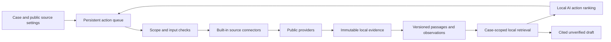

# Local OSINT engine: scope and design

Canonical architecture, updated 2026-10-15. Historical implementation/validation
receipts remain in [validation.md](validation.md); their older limits are not the
current configuration contract.

## Outcome and scope

A person, organization, domain, topic or other subject starts an investigation
without needing a Wikipedia entry. Public collection is external; evidence,
extraction, search, namesake comparison and optional llama.cpp processing are local.
The app exposes source settings, actual inputs/results and recovery controls.
Existing cases and original evidence must survive upgrade and interrupted work.

The implementation extends the existing standard-library Python/SQLite engine,
authenticated static UI, owned nginx and owned local model. New connectors use
one trusted registry and dispatcher. No cloud processing, arbitrary plugins,
password-reset enumeration, breach aggregation, login bypass or shell tools are
introduced. The OSINT4ALL catalogue informed curation; bookmarks are not executable
configuration and the catalogue is never imported wholesale.

## Architecture

| Module | Responsibility |
| --- | --- |
| `engine.py` | Cases, immutable originals, extraction, consistent export/backup and schema opening |
| `workspace.py` | Schema-2 migration, persistent actions/attempts/events, candidates, exact-passage claims, source health and retrieval |
| `connectors.py` | Trusted source metadata, exact input validation, response normalization and original retention |
| `frontier.py` | Public-scope enforcement, queue seeding/selection/dispatch and new source-driven follow-ups |
| `investigation.py` | Existing discovery, provider recovery, useful-page accounting, budgets, job control and AI integration |
| `ai.py`, `prompts.py` | Owned cached-model runtime, bounded action/extraction/draft requests and eight configurable prompt stages |
| `search_service.py` | Explicit official-image setup and ownership-scoped SearXNG lifecycle |
| `owned_process.py`, `nginx.py`, `server.py` | Owned-process receipts, loopback proxy/API, authentication and page leases |
| `static/` | Source configuration, run controls, visible queue/tool outcomes, candidate observations and evidence inspection |

Python runtime requires no third-party packages. FTS5 is optional and falls back
to local literal matching. nginx is required by canonical launch, llama.cpp and a
cached GGUF by optional analysis, Docker by optional metasearch. Dependency setup
is explicit; an investigation cannot silently install them.

## Source registry and configuration

Eight source adapters cover Crossref, GitHub public API, selected GitHub/GitLab
public profiles, website/feed/sitemap source discovery, Wayback availability,
GeoNames public-place references, local email-header analysis and owned SearXNG.
Existing public search, encyclopedia, news, page and domain tools remain canonical.
The registry declares inputs, destination families, target types, provenance,
licence, bounds and current availability. Settings select trusted implementations;
they cannot define executable handlers or arbitrary endpoints.

Case source settings are:

| Key | Contract |
| --- | --- |
| `packs` | Selected registry IDs; default website-source discovery |
| `public_usernames` | Up to 100 explicitly approved handles; automatic checks do not expand this list |
| `seed_urls` | Up to 100 public HTTPS starting URLs, distinct from private case identifiers |
| `runtime_seconds` | Nonnegative exact integer; default 300; zero removes the soft elapsed deadline |
| `keep_working` | Page-scoped continuous-work selection; does not remove independent budgets or cancellation |

The UI saves these before Start/Continue. Single-source forms authorize exact
shown inputs independently. Recovery rechecks current permissions at dispatch.
Source results distinguish success, empty, blocked, rate-limited, uninterpretable
and error. Original response bytes are saved where available, including supported
HTTP failure responses; absence of interpretable records is not false proof of no
public footprint. Public-profile success requires matching account metadata;
HTTP status alone does not establish existence or target ownership.

## Persistent work and recovery

Actions persist connector, exact arguments, purpose, candidate/evidence lineage,
priority, attempts, result/error and cooldown. The deduplication key preserves
phrases, operators, pagination and source/candidate scope. New work can arise from
approved starting URLs, selected structured sources or relevant discovered links,
feeds, sitemaps and public metadata. A finite keyword list is no longer the only
mechanism for continued collection.

Local AI can choose offered action IDs. Repetition, invalid output or unavailable
model planning falls back to deterministic queue order. Existing adaptive web
search still changes public strategy/provider. The UI exposes retry, skip,
prioritize, edited rerun and resume without discarding earlier attempts/evidence.

States include pending, running, cooldown, blocked, complete, failed, skipped and
`interrupted_after_dispatch`. Dispatch records intent before the external read;
completion records outcome afterward. A hard crash between them leaves an unknown
remote outcome. Resume can repeat read-only requests and preserves the prior
attempt. No distributed exactly-once guarantee is possible. Cooldown/connector
health survives restart and retry cannot erase an active rate-limit deadline.

Request ceilings, useful-page goals, Stop and per-request bounds operate separately
from elapsed runtime. Keep-working does not wait forever for nonexistent public
leads or promise useful output. Closing the last page checkpoints work and stops
owned services; reopening requires an explicit resume/continue request.

## Evidence, candidates and local AI

Original evidence remains in the existing evidence table. Versioned searchable
text copies record original/text hashes. Claim references bind a candidate,
original ID, extraction ID/version, exact character range, quote and supporting
or contradicting relation. Every quote must match that exact stored span; ambiguous
repeated quotes need explicit offsets. Cross-case references and generated local
reports are refused as observation support.

Candidate creation is conservative and source-backed. Namesakes stay separate;
automatic observations remain unconfirmed. Claim states represent unconfirmed,
supported, disputed and rejected assertions. Readability, relevance, attribution
and corroboration remain separate concepts. Snippets, copies and common names do
not create confirmed identity. An exact quote proves textual correspondence,
not a model's semantic inference or source truth.

The UI presents candidate → observation → evidence relationships in an accessible,
candidate-filtered table. Supporting and contradicting edges remain distinct.
A chronological observation list uses local recording timestamps, not inferred
event dates. These views expose provenance without a force-layout graph or inferred
social links; each view bounds display to 80 entries and exports retain all data.

Local extraction produces concise, literal observations from source passages.
Case-scoped retrieval uses FTS5 where available, with literal-search fallback;
returned passages carry offsets and hashes. Draft selection prioritizes retrieved
evidence before bounded source projections, so relevant later sources can enter
context. Model window/output bounds still apply; this is retrieval rather than
unbounded reading or guaranteed comprehensive analysis.

Eight prompt stages are user configurable: `plan`, `repetition`,
`provider_failure`, `no_useful_pages`, `identity_ambiguity`, `draft`, `action`,
`extract`. Each is bounded to 4,000 characters and all stages to 12,000 combined.
Prompts guide behavior but cannot widen network permission, provider/URL scope,
private-clue rules or the tool registry. Source text is untrusted data.

Private identifiers and private context only inform local comparison. Approved
public query/context and explicit source inputs are outbound data. Literal clue
and contact guards reduce unintended echoes; inference/paraphrase remains a local
privacy risk requiring human review before sharing drafts or exports.

## Owned SearXNG boundary

Only an explicit setup/start action pulls an official SearXNG image. Image tags or
digests are restricted to `docker.io/searxng/searxng`; setup stores the immutable
image ID. Container creation disables pulling and uses that ID, generated private
configuration, ownership labels and resource restrictions. No host bind mount,
Docker socket or published port is supplied.

A fixed Docker-exec client calls only the owned service's container-private
loopback API. JSON output is enabled; upstream engines are selected from Bing,
DuckDuckGo and Brave, timeouts bounded, retries disabled. Query reports include
upstream failures and configured engine fanout, which is not exact HTTP traffic
accounting. Docker itself remains externally managed.

SearXNG external requests do not inherit core pinned HTTPS transport. This extra
trust boundary is explicit in the UI/security documentation. Returned pages still
use the core collector. Native image startup and engine reliability require
separate qualification; a mocked Docker lifecycle is not equivalent evidence.

Ownership receipts support reconciliation after parent death. Control/cleanup
requires matching ownership and image identity; uncertain ownership is retained
for recovery. Normal final-page closure stops owned search/model/nginx/backend;
crash cleanup remains subject to lease expiry, OS and Docker availability.

## Upgrade and rollback

Opening schema 1 performs one in-place upgrade to schema 2 after a consistent,
integrity-checked, owner-only `backups/schema1-<unique-id>.sqlite3` backup. Workspace
tables and local index are added transactionally. Existing evidence/case IDs,
original bytes, hashes, old reports and metadata remain. Historic execution is
imported conservatively, without verified-identity promotion or outbound activity.

Before upgrade, stop other writers. Rollback stops all app/CLI processes and
restores the retained backup in a separate private directory. The current app
will upgrade it again; use a compatible previous app version to retain schema 1.
No automatic downgrade, deletion or backup pruning exists. Migration tests and
actual-case integrity receipts are distinct acceptance evidence.

## Acceptance and qualification

| Requirement | Required evidence |
| --- | --- |
| Existing cases/originals preserved | Schema-1 migration, backup integrity, original-ID/byte/hash comparison and rollback fixture |
| Ordinary-person collection without encyclopedia | Controlled search-to-page-to-claim workflow and separate live-provider checks |
| Recoverable queue | Interrupted dispatch, persisted attempts/cooldown, resume/retry/skip/prioritize and retained evidence |
| Namesakes and claims | Separate candidates, invalid/cross-case span rejection, contradictory support and unconfirmed automatic observations |
| Public/private disclosure | Offline rejection, private-clue rejection, exact manual arguments and malicious-source/model proposal fixtures |
| Useful local AI | Action/extraction validation, later-source retrieval and separate native-model evidence |
| Easy app controls | Browser source settings, single-tool action, queue controls, local `.eml`, prompts and visible availability/errors |
| Owned services | Normal departure, reload/multiple-page grace, heartbeat expiry, interrupted ownership and container lifecycle fixtures |
| Optional metasearch | Explicit setup, official immutable image, no host API port, fanout/error reporting and separate native Docker qualification |

Current receipts and outstanding limitations belong in [validation.md](validation.md).
No test count, release status or live-provider success is inferred from architecture.
